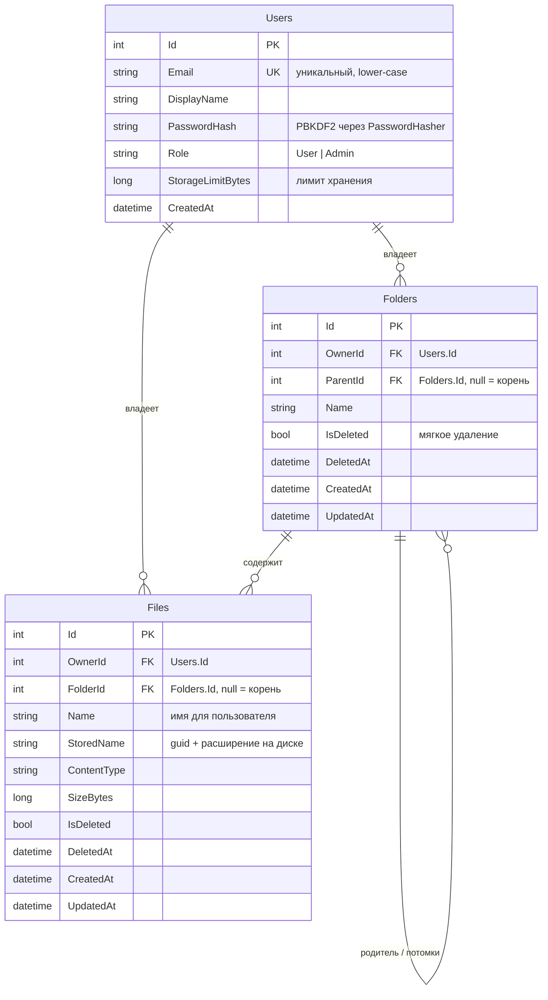

# ER-диаграмма базы данных

СУБД: **SQLite** (EF Core 10, Code First, миграции).



## Пояснения

- **Users → Folders / Files** — каскадное удаление на уровне БД не используется
  в пользовательских сценариях (удаление мягкое), но настроено для очистки данных.
- **Folders.ParentId** — самоссылка, `Restrict` защищает от случайного удаления
  папки с вложенными папками. Вложенность обрабатывается в `FilesController`.
- **Files.FolderId = null** — файл лежит в корне личного пространства.
- Индексы:
  - `Users.Email` — уникальный;
  - `Folders(OwnerId, ParentId)` и `Folders(OwnerId, IsDeleted)`;
  - `Files(OwnerId, FolderId)` и `Files(OwnerId, IsDeleted)`.
- Все выборки в приложении дополнительно фильтруются по `OwnerId`, поэтому
  пользователь не может обратиться к чужим данным даже зная идентификатор.

## Схема хранения на диске

```text
App_Data/
├── storagefiles.db          # база SQLite
└── storage/
    ├── 1/                   # userId = 1
    │   ├── 4f2c...e1.pdf
    │   └── 9ab1...77.png
    └── 2/
        └── 1c8d...44.zip
```

Отображаемые имена хранятся только в БД, поэтому переименование файла не трогает диск.
